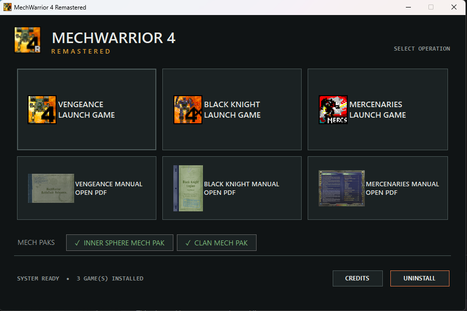
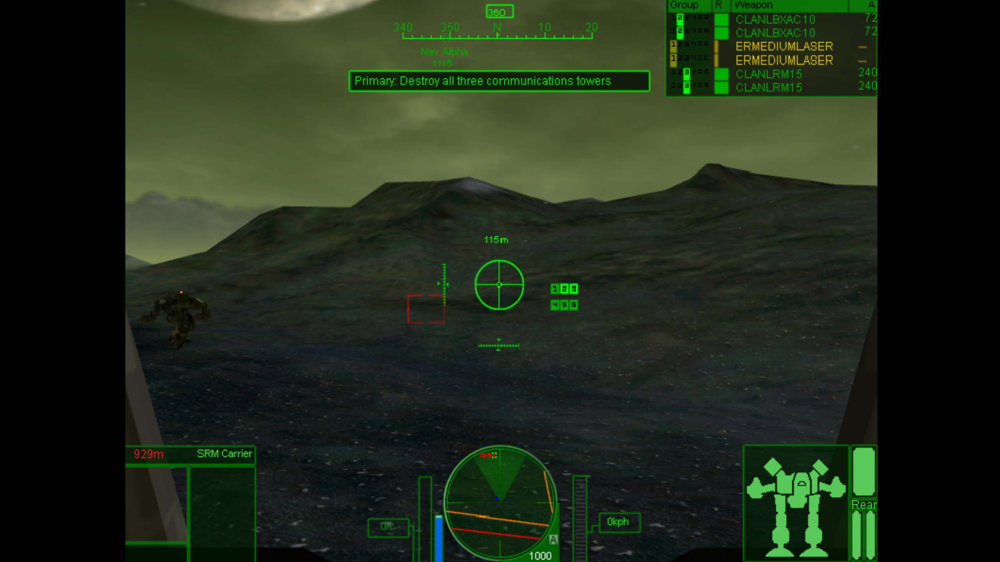
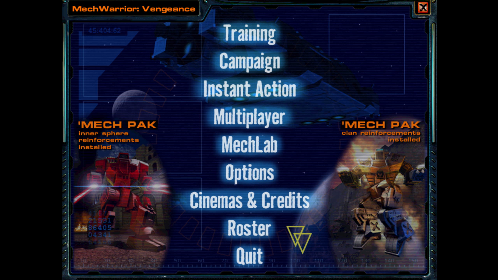
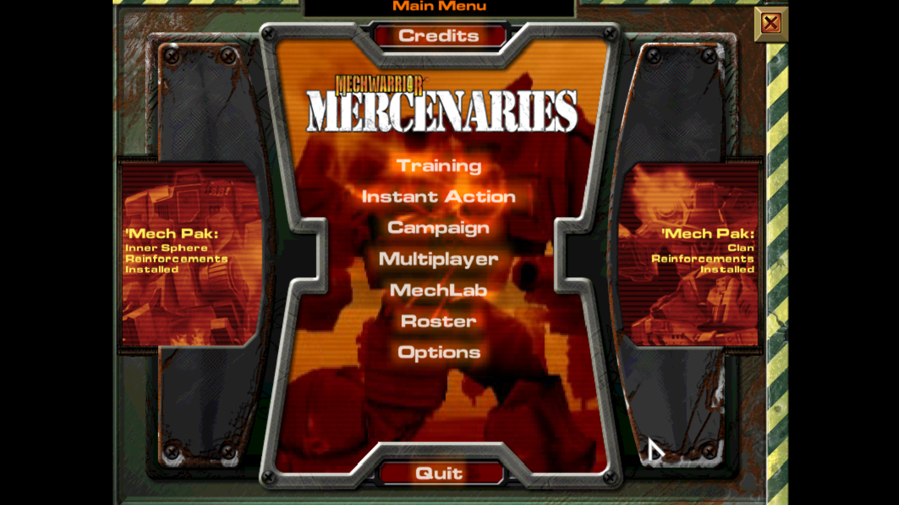

# MechWarrior 4 Remastered

An unofficial community installer for running MechWarrior 4: Vengeance, Black Knight, and Mercenaries on modern Windows. It builds the games from original media you provide, applies the required official updates and compatibility transforms, and installs one launcher for the games, Mech Paks, and cleaned manuals.

This project is not affiliated with or endorsed by Microsoft, FASA Interactive, Cyberlore Studios, The Topps Company, or any current rights holder.

## ⬇️ Download the installer

### [Download MechWarrior 4 Remastered 1.0.2 Setup.exe](https://github.com/Icehellionx/MechWarrior-4-Remastered/releases/download/v1.0.2/MechWarrior-4-Remastered-Setup-1.0.2.exe)

Current release: [1.0.2](https://github.com/Icehellionx/MechWarrior-4-Remastered/releases/tag/v1.0.2). Previous release: [1.0.1](https://github.com/Icehellionx/MechWarrior-4-Remastered/releases/tag/v1.0.1). Earlier release: [1.0](https://github.com/Icehellionx/MechWarrior-4-Remastered/releases/tag/v0.6.47.5). Older stable fallback: [v0.6.46](https://github.com/Icehellionx/MechWarrior-4-Remastered/releases/tag/v0.6.46).

1.0.2 fixes Black Knight setup under Wine and adding Mech Paks or Black Knight to an existing verified installation. It improves the Wine folder-selection page and keeps initial configuration stable on repeat setup. It retains the Mercenaries extraction, movie and display-scaling fixes from 1.0.1. Original movies stay enabled. The renderer and joystick adapter retain their qualified hashes; see the release notes for validation and hardware coverage.

The source-built joystick adapter exposes at most 31 buttons to all three games. Joystick input defaults ON for new preferences; an existing saved OFF choice stays OFF. **HELP & QUIRKS** explains mapping and limitations. The unchanged adapter's earlier native 31/32/128-button regressions and two missions with saved bindings per game passed in an isolated Windows VM. Extra buttons are omitted, not automatically remapped.

Affected PCs and physical joysticks still need field confirmation. VM runtime uses temporary software D3D11 WARP profiles; the shipped D3D12 profile fails in that VM with both the previous and current adapter. Representative GPU/default-renderer, physical HOTAS, multiple-device and force-feedback testing remain open.

The installer does **not** contain the games. Setup asks for your original ISOs, supported CUE/BIN pairs, ZIP archives or separate original-disc folders and builds the installed games from those inputs.

To upgrade or repair, run the newest setup again in the same installation folder with the original media for all games and packs already installed, plus anything you want to add. Setup repairs verified project-owned files and reapplies the remaster graphics defaults. Keep backups of customized settings and saves. The launcher's **UNINSTALL** removes verified owned game files and then the application shell, preserving unowned saves and configuration; Windows **Installed Apps** removes the launcher, manuals and shortcuts and may leave games, saves and settings. Preserve unexplained leftovers and include a sanitized file listing and retained log when reporting a problem.

Older legacy download: [v0.6.45.9012 Setup.exe](https://github.com/Icehellionx/MechWarrior-4-Remastered/releases/download/v0.6.45.9012/MechWarrior-4-Remastered-Setup-0.6.45.9012.exe). Report problems using the [guided issue form](https://github.com/Icehellionx/MechWarrior-4-Remastered/issues/new?template=bug_report.yml). Do not post game media in an issue.

1. Download and run the installer.
2. Add the ISO, supported CUE/BIN, ZIP or original-disc folders for the games and optional Mech Paks you own.
3. Open the desktop launcher and choose a game or manual.

For Wine, extract each original disc into a separate regular folder, then use **Add folder** in Setup. Vengeance needs both disc folders; add the Black Knight and complete Mech Pak media you own as well. Black Knight also needs the official update supplied by supported Mech Pak media. Mounted disc roots and symbolic links are rejected. Wine 11 / Ubuntu 24.04 passed Vengeance installation, adding both packs and Black Knight, repeat setup, native folder selection, and save-preserving removal. Linux gameplay, the reported CachyOS/Proton runner, and a full Mercenaries Wine lifecycle still need confirmation.

If the direct link does not work, open the [1.0.2 release page](https://github.com/Icehellionx/MechWarrior-4-Remastered/releases/tag/v1.0.2) and download the setup EXE under **Assets**.

## Screenshots

| Launcher | Vengeance gameplay |
| --- | --- |
| [](docs/screenshots/launcher.png) | [](docs/screenshots/vengeance-gameplay.png) |

| Vengeance main menu | Mercenaries main menu |
| --- | --- |
| [](docs/screenshots/vengeance-main-menu.png) | [](docs/screenshots/mercenaries-main-menu.png) |

## Windows warning and checksum

The installer is currently unsigned. Windows may display **Unknown publisher** or a Microsoft Defender SmartScreen warning. Verify the SHA-256 digest before deciding whether to run it; never disable SmartScreen or antivirus protection globally for this project.

SHA-256 for the 1.0.2 download:

```text
510901c9a2294ef693527920ba26f75a82d38b689ac4c000d6ff2585f6838326
```

```powershell
Get-FileHash .\MechWarrior-4-Remastered-Setup-1.0.2.exe -Algorithm SHA256
```

## What you need

- Windows 10 or Windows 11 on an x64 PC.
- Original MechWarrior 4 media supplied as supported ISO files, single-track MODE1/2352 CUE/BIN pairs, ZIP archives or separate original-disc folders.
- Vengeance is required before installing Black Knight or the retail Inner Sphere/Clan Mech Paks.
- Mercenaries is independent.
- Enough free space for the selected games plus temporary extraction space.

The installer accepts supported combinations of Vengeance discs 1 and 2, Black Knight, Mercenaries discs 1 and 2, the Inner Sphere Mech Pak, and the Clan Mech Pak.

No ISO, serial key, or extracted proprietary game tree is committed to this repository.

## What setup does

- Validates supported media before committing game files.
- Installs Vengeance, Black Knight, Mercenaries, and either optional Mech Pak in their original dependency arrangement.
- Applies the required official updates and reproducible no-disc/compatibility transforms from validated inputs.
- Installs a single MW4-styled launcher for all detected games and manuals.
- Presents every game in a centered, borderless, aspect-correct 4:3 viewport without changing the physical desktop resolution.
- Settings previews the centered 4:3 image for common 16:9 (900p, 1080p, 1440p, 4K), 16:10 (1200p, 1600p), and ultrawide (2560×1080, 3440×1440, 5120×2160) monitors. The installed game always uses your current Windows monitor mode; selecting a preview does not switch display resolution.
- Automatically renders the 3D world at the largest game-safe 4:3 resolution fitting the monitor containing the launcher, then scales the centered picture to that monitor.
- Defaults to the games' Ultra High-equivalent detail settings, 32-bit color, 4× MSAA, and 16× anisotropic filtering.
- Keeps menus, gameplay, and all ordinary cinematics at their original aspect ratio. Only the live-action portion of Vengeance's opening receives a proportional widescreen cover treatment; it is never stretched.
- Includes a game-local movie-decoder compatibility workaround for Vengeance and Mercenaries; original videos remain enabled.
- Includes a hash-verified game-local DirectInput adapter and a joystick ON/OFF button in the launcher for all three games. It installs no virtual joystick driver.
- Keeps the game picture visible during Alt-Tab, releases the cursor while inactive, and recaptures it on return.
- Removes the dgVoodoo watermark and applies a small gameplay-only top/left seam correction.
- Activates installed Inner Sphere and Clan content across chassis, weapons, and subsystems without bypassing the original model loader.
- Includes the three cleaned game manuals and launcher cover art.
- Creates a desktop shortcut by default and registers a standard Windows uninstaller.
- The launcher's UNINSTALL removes verified owned game files and then the application shell, preserving unowned saves and configuration. Windows Installed Apps removes the shell and may leave games and user files.

## Known limitations

Joystick input defaults ON when no preference has been saved; an explicit OFF choice is preserved. Adapter errors are reported for the selected game without silently disabling joystick input globally. **HELP & QUIRKS** explains controls and workarounds inside the launcher.

MW4 can crash when a device exposes 32 or more buttons. The source-built adapter now exposes at most 31 buttons to these games and safely omits excess buttons; it does not automatically remap them or expand the original binding screen's supported range. Use controller software or a user-configured tool such as Joystick Gremlin to map extra or ignored buttons to keyboard keys. The exact release adapter passed native 31/32/128-button tests and two mission loads with saved in-mission bindings in all three games in an isolated Windows VM. Physical HOTAS, multi-device combinations and force feedback remain field gaps. See the [input research and qualification record](active/INPUT_DISPLAY_RESEARCH.md).

- The release is not Authenticode-signed, so Windows cannot show a verified publisher.
- The NVIDIA/Windows 11 field evidence is from earlier builds. Confirmation of 1.0.2 on affected PCs and additional GPUs, display layouts, and unusual archival media variants remains open.
- Modified, regional, or otherwise unrecognized media fail closed instead of receiving a guessed transform.
- First-launch mouse placement on other display configurations and gameplay on other GPUs still need field testing. The ultrawide client-area and mouse-capture corrections in v0.6.46 passed local component tests but still need reports from the affected ultrawide and Windows 10/RX 6750 XT systems; [issue #7](https://github.com/Icehellionx/MechWarrior-4-Remastered/issues/7) and [issue #8](https://github.com/Icehellionx/MechWarrior-4-Remastered/issues/8) still need affected-system confirmation; see the original reports.
- Standalone Vengeance may still show its original first-launch license after accepting Setup's checkbox. Review the original game terms separately if prompted; Setup's checkbox does not guarantee that this legacy prompt is skipped.
- The game-local decoder workaround and standalone Vengeance surface-lifetime correction address different movie paths. Standalone natural intro completion, skip, relaunch and normal exit passed in the VM; cinematic archive replay and campaign-cutscene transitions remain unqualified. Confirmation on affected hardware remains open; see [issue #10](https://github.com/Icehellionx/MechWarrior-4-Remastered/issues/10) and [issue #15](https://github.com/Icehellionx/MechWarrior-4-Remastered/issues/15). On a PC without another usable decoder, affected movie audio may be absent.
- Complete campaigns, physical sticks, multiple-device layouts and force feedback remain field gaps. All three titles passed two mission loads with saved bindings and harmless excess-button input using the exact adapter in a VM software-renderer fixture.
- The tested reduced Clan archive does not provide the qualified official Patch 3 payload. Use complete pack media containing the required official updates, or include qualified Inner Sphere media. Black Knight likewise requires qualified pack media for its official PR1 update; incomplete selections fail with an explanation.

## Reporting a bug

For a failed reinstall, include whether rerunning setup in the same folder with the same original media changed the result. Include the exact step, setup exit code and sanitized retained installer log; preserve unexplained leftover files while we investigate.

Use the [guided bug report form](https://github.com/Icehellionx/MechWarrior-4-Remastered/issues/new?template=bug_report.yml). Include the game, media type, exact step, and retained installer log when relevant.

Before uploading diagnostics, remove personal paths or other private information. Never attach ISOs, extracted game files, serial keys, credentials, or unrelated crash artifacts.

## Development

The application source is under `src`, packaging is under `packaging`, focused contracts are under `tests`, and pinned third-party provenance is under `third_party`.

```powershell
dotnet run --project tests/MW4Remastered.Core.Tests/MW4Remastered.Core.Tests.csproj --configuration Release
dotnet run --project tests/MW4Remastered.Launcher.Tests/MW4Remastered.Launcher.Tests.csproj --configuration Release
./tests/ApplicationPrivilegeBoundary.Tests.ps1
./tests/CompatibilitySourceBuild.Tests.ps1
./tests/PackagingContract.Tests.ps1
./tests/PresentationCompatibilityContract.Tests.ps1
./tests/ReleaseTreePolicy.Tests.ps1
./tests/UserFlowContract.Tests.ps1
```

See [BUILDING.md](BUILDING.md) for the complete local-input and release-build contract. Release binaries are published through GitHub Releases rather than committed to Git history.

## License

Original project source is available under the [MIT License](LICENSE). That license does not grant rights to MechWarrior, BattleTech, the original games, manuals, trademarks, or third-party components. See [REDISTRIBUTION.md](REDISTRIBUTION.md) and [third-party notices](third_party/THIRD-PARTY-NOTICES.md).
